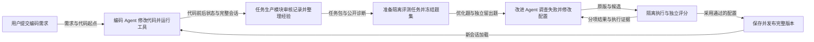

# TraceWaltz

把编码过程变成可复现任务，再用任务反馈改进 Coding Agent 的工作方式。

TraceWaltz 是一个围绕编码执行、任务沉淀和策略改进构建的 Agent 系统：执行编码需求，保存过程与测试反馈，整理为可复现任务，再由改进 Agent 调查失败、修改候选配置，通过独立评测决定是否用于后续编码。

**状态：开发中，完整自动化闭环正在验收。** 已有真实编码、任务生产、容器评测和候选修改记录；正常配置的持续收益仍需更多对照。项目改进提示词、Skills、插件和工作流等运行策略，不更新模型权重。



## 能做什么

- 在隔离的代码副本中执行编码，保存原始会话、工具调用、前后代码和测试结果。
- 通过任务发现、价值判断、构建和验证四类审核，生产任务，并提供难度标定、加难和经验处理入口。
- 将任务包整理为隔离执行材料，分别管理题目、起始代码、环境、私有评分材料和参考实现。
- 使用能读取证据、运行工具和修改配置的改进 Agent，生成候选版本并执行搜索比较。
- 保存功能分项、严格验证与完整公开反馈；冻结比较题集，留出任务不交给改进端。
- 通过采用检查后发布完整配置，后续编码会话加载指定版本；中断后保留状态并核对恢复。

## 安装与开始

完整运行使用 Linux，Windows 建议使用 Ubuntu 24.04 / WSL2。需要 Docker、Python 3.12+、Git、curl、xz，以及可用的模型服务。依赖安装和容器构建需要网络；真实模型请求会计入本项目账本。

```bash
git clone https://github.com/talented-canola/TraceWaltz.git
cd TraceWaltz
cp .env.example .env
# 在 .env 中填写自己的 DEEPSEEK_API_KEY 和模型名称
```

接着按[安装说明](docs/INSTALL.md)准备依赖，按[使用说明](docs/USAGE.md)运行。`.env`、运行目录和执行日志默认忽略，不进入 Git。

```bash
bash tools/linux-env.sh .runtime/linux-python/bin/tracewaltz --help
```

## 系统组成

| 部分 | 职责 |
| --- | --- |
| 编码执行 | 在代码副本中完成需求，保存修改和工具反馈 |
| 任务生产 | 审核执行记录，构建可复现任务并整理经验 |
| 配置改进 | 调查失败，修改候选策略、插件与工作流 |
| 评测与发布 | 隔离执行、独立评分、候选比较和版本采用 |

运行时在本项目下生成 `.runtime/`、`.state/` 和 `artifacts/`，分别保存依赖、状态和执行产物。任务包、重复运行和冻结副本分别管理。

## 验证

安装 Python 依赖后运行本地回归：

```bash
mkdir -p .test-work
.runtime/linux-python/bin/python -m unittest discover -s tests -v
```

这些回归主要检查确定性契约和本地集成。真实模型、Docker 任务执行、独立留出和采用发布另行运行，不能用单元测试通过替代完整链路验收。

