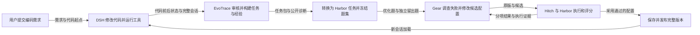

# TraceWaltz

把编码过程变成可复现任务，再用任务反馈改进 Coding Agent 的工作方式。

TraceWaltz 连接 **DeepSeek Harness（DSH）＋EvoTrace＋Gear**：DSH 读取和修改代码，EvoTrace 从记录构建任务与经验，Gear 运行真实改进 Agent、比较候选配置，并通过独立留出任务决定是否采用。

**状态：开发中，完整自动化闭环正在验收。** 已有真实编码、任务生产、容器评测和候选修改记录；正常配置的持续收益仍需更多对照。项目改进提示词、Skills、插件和工作流等运行策略，不更新模型权重。



## 能做什么

- 在隔离的代码副本中执行编码，保存原始会话、工具调用、前后代码和测试结果。
- 保留 EvoTrace 的四角色审核、任务构建与验证、标定、加难和经验处理入口。
- 把 EvoTrace 任务转换为 Harbor 执行格式，分别提供题目、环境、私有评分材料和参考实现。
- 调用 Gear 原生搜索，使用可读文件、运行工具和修改配置的 DSH 改进 Agent。
- 保存功能分项、严格验证与完整公开反馈；冻结比较题集，留出任务不交给改进端。
- 通过采用检查后发布完整配置，后续编码会话加载指定版本；中断后保留状态并核对恢复。

## 安装与开始

完整运行使用 Linux，Windows 建议使用 Ubuntu 24.04 / WSL2。需要 Docker、Python 3.12+、Git、curl、xz，以及可用的模型服务。依赖安装和容器构建需要网络；真实模型请求会计入本项目账本。

```bash
git clone https://github.com/talented-canola/TraceWaltz.git
cd TraceWaltz
cp .env.example .env
# 在 .env 中填写自己的 DEEPSEEK_API_KEY 和模型名称
```

接着按[安装说明](docs/INSTALL.md)准备依赖，按[使用说明](docs/USAGE.md)运行。`.env`、运行目录和执行日志默认忽略，不进入 Git。

```bash
bash tools/linux-env.sh .runtime/linux-python/bin/python -m evotrace_bridge --help
```

## 代码结构

| 目录 | 职责 |
| --- | --- |
| `evotrace_bridge/` | 编码记录、任务转换、原生评测连接、改进执行、采用发布与整轮状态 |
| `harness/` | DSH 启动、工具和模型服务接入，以及容器构建材料 |
| `target/` | 被评测和改进的初始 Agent 配置 |
| `tools/` | 安装、运行环境、配置检查和独立工作流评价入口 |
| `patches/evotrace/` | 对固定上游版本的集成补丁与上游许可证 |
| `tests/` | 契约、隔离、评分、状态恢复及发布等本地回归 |
| `examples/` | 人工编写的布尔解析、分页和超时配置练习仓库 |

运行时在本项目下生成 `.runtime/`、`.state/` 和 `artifacts/`，分别保存依赖、状态和执行产物。任务包、重复运行和冻结副本分别管理。

## 验证

安装 Python 依赖后运行本地回归：

```bash
mkdir -p .test-work
.runtime/linux-python/bin/python -m unittest discover -s tests -v
```

这些回归主要检查确定性契约和本地集成。真实模型、Docker 任务执行、独立留出和采用发布另行运行，不能用单元测试通过替代完整链路验收。

## 上游关系

TraceWaltz 复用 DSH 的执行机制、EvoTrace 的任务与经验处理、Gear 的搜索比较以及 Hitch / Harbor 的执行评测。集成层负责数据转换、证据对应、真实 DSH Meta 连接和配置发布。具体版本见 `dependencies.lock.json`，来源与许可证见 [THIRD_PARTY.md](THIRD_PARTY.md)。
